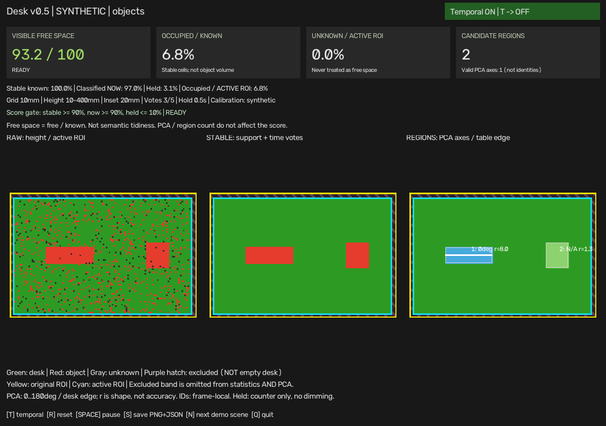

# Desk Clutter MVP

用 RealSense 深度数据观察桌面的**可见空间占用、候选区域与 PCA 方向**。
目标是可操作、可解释、可复现的 70 分原型，不是通用物体识别或主观整洁评分。

**当前主入口：`desk_status_v05.py`。** 默认绝对高度模式；薄电脑漏检时可显式使用局部空桌参考模式。
`desk_debug_v2.py` 是早期四角标定和照片对照工具，不是新版面板。



## 先选你的启动场景

| 你现在要做什么 | 从哪里开始 |
| --- | --- |
| 没有相机，先看看程序 | 第 1 节：合成演示 |
| 已有正确标定，直接看桌面 | 第 2 节：日常启动 |
| 已有标定，电脑很薄、缺口多 | 第 3 节：空桌参考模式 |
| 换了相机位置，或第一次使用 | 第 4 节：首次标定 |
| 不清楚红点、灰色或 N/A 的原因 | 第 6 节：排查与文档 |

以下命令都在项目根目录执行。Linux/macOS 使用 `.venv/bin/python`，Windows 对应 `.venv\Scripts\python.exe`。
本机当前文件的具体启动命令另存于 `data/CURRENT_SETUP.md`，不随公开仓库发布。

## 1. 安装与无相机演示

需要 Python 3.10+。依赖使用兼容版本范围，不保证每个系统都有 RealSense / Open3D 安装包。

```bash
python3 -m venv .venv
.venv/bin/python -m pip install -r requirements.txt

# N 依次切换：空桌、物体、旋转、移除、缺测
.venv/bin/python desk_status_v05.py --demo

# 无 GUI / 相机：保存 view.png + report.json 后退出
.venv/bin/python desk_status_v05.py --demo --headless --output-dir /tmp/desk-v05-demo

# 可选局部模式：合成的 8mm 物体、局部偏差与独立噪声
.venv/bin/python desk_status_v05.py --demo --demo-background

# 自动测试，不会启动相机
.venv/bin/python -m unittest discover -s tests -v
```

演示不读取个人标定，不需要相机 SDK 或 Open3D。`--demo-scene` 可选
`empty|objects|rotated|removed|missing`；单独启动 removed 就是空桌，连续移除过程用 N 观察。
仅做 headless 时可在独立环境安装 `opencv-python-headless` 替代 GUI 版，不要混装两个 OpenCV 包。

## 2. 日常启动：已有标定

先安装实时依赖，关闭其他占用相机的程序。机位、桌子和灯光应与标定/参考采集时一致。

```bash
.venv/bin/python -m pip install -r requirements-live.txt

# 选择自己已检查的标定；若使用多帧候选，改成 candidate_calibration.json 的实际路径
DESK_CALIBRATION=calibration.json
.venv/bin/python desk_status_v05.py --calibration "$DESK_CALIBRATION"
```

这是**绝对高度模式**：默认 10mm 网格，物体高度 10-400mm，桌边内缩 20mm。
不自动挑选“最新候选”，不覆盖标定，不使用旧版 B 键的占用率基线。
画面应显示 `LIVE`、`Temporal ON`；合成演示会明确显示 `SYNTHETIC`。

## 3. 可选局部空桌参考：薄电脑漏检时使用

### 3.1 只在没有可用参考，或场景改变时采集

先清空**整个 ROI**，包括电脑、手机、电线等。固定相机、桌面和灯光，避免台灯直射问题区域。
沿用第 2 节所选的同一份标定：

```bash
.venv/bin/python desk_height_background.py --calibration "$DESK_CALIBRATION"
```

等待画面稳定，按 **C** 采集默认 5 秒；保存成功后按 **Q** 退出。
终端会打印新参考路径及可直接复制的 v05 启动命令。失败时不要进入下一步。
程序不能替你识别“空桌上其实还留着电脑”。

### 3.2 已有参考时直接启动，不必每次重新采集

```bash
# 换成自己的实际目录名；不要原样输入“时间戳”
DESK_BACKGROUND=data/height_backgrounds/background_时间戳/background.json
.venv/bin/python desk_status_v05.py \
  --calibration "$DESK_CALIBRATION" \
  --background "$DESK_BACKGROUND"
```

界面出现 `LOCAL delta gate` 即为局部模式。比较每格“当前高度 - 空桌高度”，
增加短时高度中位数和按空桌噪声设置的门槛，再复用状态投票、区域提取和 PCA。
不再使用绝对模式的 10mm 下限和 60% 物体点规则，**不要再去改 calibration.json 的高度参数**。

参考与标定哈希、网格或采样设置不匹配会拒绝加载。相机移动需重做标定与参考；
灯光/桌面/设备改变后需重采参考。无可靠参考或无当前数据的格保持未知。
去掉 `--background` 就回到绝对模式，不需要覆盖文件。

### 3.3 最小现场验收

保持 Temporal ON：空桌观察 10 秒 → 放入电脑观察 10 秒 → 旋转 → 拿走 → 检查恢复。
每个稳定场景按 S 留存 PNG + JSON。**参考采集图不是独立空桌验收。**
现场试验已观察到连续电脑区域、主要边界轻微抖动及移除后恢复；方向仍可能抖动或 N/A，
不视为完整稳定性认证。最新范围与证据见 [发布验证记录](docs/reports/RELEASE_READINESS.md)。
见 [空桌参考指南](docs/guides/BACKGROUND_HEIGHT_GUIDE.md) 和 [验收清单](docs/checklists/V05_ACCEPTANCE.md)。

## 4. 首次使用或机位移动：标定流程

```bash
.venv/bin/python -m pip install -r requirements-calibration.txt
.venv/bin/python desk_debug_v2.py
```

旧工具提示时选 R 重新标定，在照片里点击四个桌角，核对两侧编号，Enter 保存。
**它会写 calibration.json，重做前先备份。** 四角错误、拟合成墙面要在此纠正。
详见 [照片对照与四角标定](docs/guides/LEGACY_WORKFLOW.md)。

如果四角大体正确，但空桌远端持续偏高，可另做小幅平面细化：

```bash
.venv/bin/python desk_calibrate_multiframe.py --calibration calibration.json
```

清空整个 ROI，按 C 拟合，再按 V 采集**另一段新数据**独立验证。检查报告后，
才在 v05 的 `--calibration` 中指定候选。不自动启用、不覆盖原标定。
它修正参考平面，不消除逐帧噪声。见 [多帧标定指南](docs/guides/MULTIFRAME_CALIBRATION_GUIDE.md)。

## 5. 界面、按键与指标

| 显示项 | 定义 / 注意事项 |
| --- | --- |
| 左栏 | 默认模式为原始高度分类；局部模式为当前单格高度差分类 |
| 中栏 | 稳定状态；局部模式额外经过短时高度中位数 |
| 右栏 | 候选连通区域和 PCA，不是语义识别；编号不跨帧跟踪 |
| Visible free space | `100 × FREE / (FREE + OCCUPIED)`，只统计 active ROI 内已知状态 |
| Occupied / known | `100 × OCCUPIED / (FREE + OCCUPIED)` |
| Unknown / active ROI | 未知格 / 全部有效 ROI；未知不补成空桌 |
| Classified NOW / Held | 当前已分类率 / 本帧不支持但保留的旧状态比例 |
| PCA N/A | 区域太小或主轴不突出，不代表没有检测到占用 |

绿色=桌面，红色=占用，灰色=未知，紫色纹理=排除带；黄色=原 ROI，青色=有效 ROI。
分数要求 Temporal ON、未暂停、稳定已知率≥90%、当前已分类率≥90%、Held≤10%。
否则显示 N/A，JSON 为 null。READY 是显示门限通过，不是准确率认证。
角度和区域数不影响分数；小占用斑块即使没有 PCA 也参与计数。

### 可选：单独对照 PCA 方向门槛

v05 支持 `--pca-ratio`，默认仍是 `2.5`。在相同启动命令末尾加 `--pca-ratio 1.5`
可试验较宽松的方向门槛；右栏标题和保存报告中的 `settings.pca_ratio` 会显示实际值。
只影响区域是否输出角度，不改高度分类、滤波、区域面积或分数；5cm 最小主轴跨度仍有效。
无需重新采集参考。此试验值尚未通过真实旋转验收，不保证方向更准确。

固定机位、参考和 Temporal ON，测试静止、缓慢旋转、拿走：观察是否突然跳约 90°、
频繁在角度与 N/A 间切换，或空桌出现假方向；各稳定场景按 S 保存。
若表现更差，退出后去掉参数或改回 `--pca-ratio 2.5` 即可。

如果小噪声区域产生假方向，可另加 `--min-pca-area-cm2 50`，试验只让实际占用面积
至少 50cm² 的候选区域输出方向。面积按占用格数计算，不按外接矩形计算；
10mm 网格下 50cm² 对应 50 格，换网格时仍按物理面积判断。
面积不足的区域仍保留、仍参与占用统计，但角度为 N/A，报告 reason 为
`area below PCA minimum`。面积足够也必须通过原有主轴比例和跨度条件。
默认 `--min-pca-area-cm2 0` 不启用额外面积限制；50 是待现场验收的试验值。
保持 `--pca-ratio 1.5` 和其他参数不变，对照空桌假方向、电脑停稳/旋转和移除恢复。
它不消除噪点，也不保证解决电脑角度抖动；无需按 C 重采参考。
详见 [方向面积门槛试验](docs/reports/PCA_AREA_TRIAL.md)。

| 按键 | v05 操作 |
| --- | --- |
| T | 开关时间稳定；默认 ON，首次按是关闭；局部模式同时切换高度滤波和状态投票 |
| R | 重置时序历史，不改标定/空桌参考 |
| Space | 暂停/恢复；恢复时重置历史 |
| S | 保存 view.png + report.json，不覆盖已有结果 |
| N | 仅演示模式：切换场景 |
| Q / Esc | 退出并释放相机 |

默认结果在 `outputs/v05_时间戳/`。本机整理后 outputs 是指向 data/outputs 的兼容链接。
JSON schema v2 记录指标、参数、区域、标定/参考哈希；不含 RGB 或原始点云，但可能暴露布局。

## 6. 排查与文档

顺序：核对模式/标定 → 看当前覆盖率和未知 → 看高度偏差/时间波动 → 检查阈值/时序 → 最后处理区域/方向。
不要降低质量门限或补洞，把缺测包装成干净桌面。

```bash
# 只读诊断：C 采集，点击查看，S 保存选点，不更改标定
.venv/bin/python desk_height_diagnostic.py --calibration "$DESK_CALIBRATION"
# 手动相机检查，不属于自动测试
.venv/bin/python experiments/test_camera.py
```

- [文档导航](docs/INDEX.md)
- [知识点手册](docs/reference/KNOWLEDGE_HANDBOOK.md)
- [目录职责与迁移说明](docs/reference/PROJECT_LAYOUT.md)
- [高度诊断指南](docs/guides/HEIGHT_DIAGNOSTIC_GUIDE.md)
- [软件验证记录](docs/reports/BACKGROUND_HEIGHT_TEST_REPORT.md)
- [发布前检查](docs/checklists/RELEASE_CHECKLIST.md)

## 7. 项目目录

```text
README.md                   当前启动入口和流程
desk_status_v05.py          主面板与报告
desk_height_background.py   空桌参考和局部检测
desk_height_diagnostic.py   高度诊断、共享相机采集
desk_calibrate_multiframe.py 多帧平面细化与独立验证
desk_orientation_v04.py     检测、时序、PCA 核心
desk_debug_v2.py / desk_compare_view.py  四角标定、照片对照
desk_orientation_v03.py     历史方向对照
experiments/                早期相机、点云、RANSAC、自动 ROI 实验
docs/                       guides / reference / reports / checklists / archive
tests/                      离线自动测试
data/                       本机采集、候选、参考、结果、截图、迁移清单
output/pdf/                 本地复盘与知识手册 PDF
tools/                      文档生成工具
```

四个旧采集目录名在本机保留为兼容链接；公开仓库无需携带这些链接或个人数据。
新检出中程序会创建其原默认目录，也可显式指定 `--output-dir data/...`。
当前脚本保留根目录，保持导入和启动兼容；本次资料整理不重写检测算法。

## 8. MVP 边界与发布状态

- 可见占用代理，不是真实完整面积/体积、可操作面积或主观整洁程度。
- 薄手机、反光、强光、遮挡、缺测、远端噪声、近正方形方向仍是限制。
- 区域不等于物体身份；没有跨帧追踪、语义分类、自动轮廓补全。
- 内缩排除带里的真实物体也被忽略；无法可靠观测时允许 N/A。
- 已完成 Linux/Python 3.12 新虚拟环境中的公开副本安装、测试和合成演示；加入许可证打包测试后两环境回归共 185 项通过。未验证跨设备/系统、实时依赖全新安装或长时间角度稳定性。
- 最新范围与环境见 [发布验证记录](docs/reports/RELEASE_READINESS.md)，不以旧阶段文档代替当前结论。
- 已由作者选择 Apache-2.0；未初始化/创建/推送 Git。发布前仍检查照片、报告、个人路径和依赖许可。

本地复盘 PDF 含实拍证据，默认不提交 Git；不要把整个工作目录直接上传。

## 9. 发布准备

使用 `python3 tools/prepare_release.py` 生成白名单公开副本、ZIP 和 SHA-256 清单。
不会初始化或推送 Git，不携带个人标定/参考/实拍；发布包包含 LICENSE 和 NOTICE。
详见 [发布指南](docs/RELEASING.md) 和 [发布说明](RELEASE_NOTES.md)。

## 10. 作者与许可证

原作者：**MilkSpread (NGKAIEN)**，GitHub 主页：[NGKAIEN](https://github.com/NGKAIEN)。

Copyright 2026 MilkSpread (NGKAIEN).

本项目采用 [Apache License 2.0](LICENSE)，来源与署名见 [NOTICE](NOTICE)。
使用、修改和分发时请遵守许可证中的相关要求。NOTICE 不添加额外许可条件。
第三方依赖仍遵循各自的许可证，见 [第三方依赖说明](THIRD_PARTY.md)。
项目仓库地址将在实际建立后补充；作者主页不是项目仓库地址。
